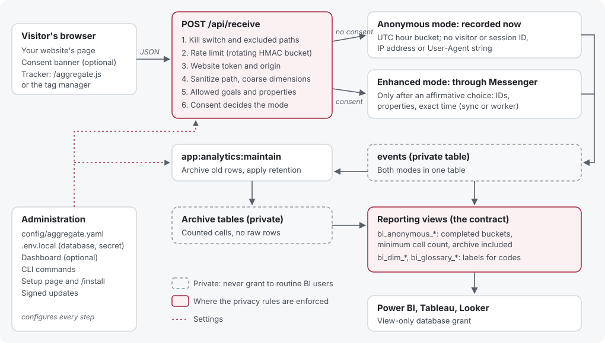

# Architecture tour

[Why Aggregate exists](WHY.md) · [Design decisions](DESIGN-DECISIONS.md) · [Glossary](GLOSSARY.md) · [File map](../CONTRIBUTING.md#architecture-and-file-map)

A walk through how Aggregate works, for people about to change it. It follows
one event from a web page to a BI report, then covers configuration,
administration, browser scripts and tests. The
[file map in CONTRIBUTING.md](../CONTRIBUTING.md#architecture-and-file-map)
lists where things live; this page explains how they fit together.

*Select the diagram to open it at full size.*

Aggregate is a Symfony application with Doctrine for database access. It has
two halves that share one database: **collection**, which is public and
protected by privacy rules, and **reporting**, which is SQL views that BI tools
read. The dashboard is an optional third part for administration.

## The life of an event

### 1. The browser sends it

A website loads the tracker, [public/aggregate.js](../public/aggregate.js), from
the installation. [ScriptController](../src/Controller/ScriptController.php)
serves it with the public settings for the website its token names: namespace,
collection profile, allowed properties and the organization-traffic marker, from
the deployment's settings or the [website group](CONFIGURATION.md#website-groups)
and website overrides layered over them. The tracker is
hand-written source with no build step; an optional minified copy is built with
Terser (see [JavaScript build](JS-BUILD.md)). A consent manager, either the
built-in one or the site's own, tells the tracker whether the visitor opted in.

The tracker posts a small JSON payload to `/api/receive`: page path, event name,
coarse dimensions, and, only with consent, identifiers and properties.

### 2. The server checks it

[ReceiveController](../src/Controller/ReceiveController.php) hands each request
to [EventIngestion](../src/Service/EventIngestion.php), which applies the rules in
this order and stops at the first one that fails:

1. **Website settings.** The token selects the website's group and website
   settings, layered over the deployment's
   ([WebsiteScopeResolver](../src/Service/WebsiteScopeResolver.php)). If either
   file cannot be read or is invalid, the event is ignored rather than collected
   under broader settings.
2. **Kill switch and excluded paths.** If collection is off
   (`anonymous_tracking_enabled`) or the sanitized path matches an excluded
   route, the event is ignored. This happens before anything else is derived
   from the request.
3. **Bots.** A request whose User-Agent or the tracker's automation report marks
   it as a bot is labelled, or with `bot_traffic: drop` ignored, before any
   rate-limit bucket or lookup. Neither value is stored.
4. **Rate limit.** [IpRateLimiter](../src/Security/IpRateLimiter.php) counts
   requests per client in one-minute windows. Each window's bucket name is an
   HMAC of the window and the address, so the file on disk cannot link the
   address across windows and the address is never stored.
5. **Website token and origin.** The public token must belong to a registered
   website ([WebsiteConfigManager](../src/Service/WebsiteConfigManager.php)), and
   the `Origin` (or `Referer`) must pass that website's domain rules
   ([WebsiteDomainPolicy](../src/Service/WebsiteDomainPolicy.php)).
6. **Sanitize.** [PrivacySanitizer](../src/Service/PrivacySanitizer.php) reduces
   the path (query strings, fragments, and identifiers such as emails, UUIDs and
   numeric IDs are removed), and turns the referrer, device and screen width into
   coarse buckets. The **strict** collection profile
   ([CollectionProfile](../src/Service/CollectionProfile.php)) keeps only the
   path, the event name and allowed goal codes, and ignores everything else,
   including consent.
7. **Goals and properties.** [GoalEventRegistry](../src/Service/GoalEventRegistry.php)
   accepts only configured goal codes, and
   [CustomDataSettings](../src/Service/CustomDataSettings.php) keeps only
   properties the data model allows. Anonymous events accept only those
   explicitly allowed without consent.
8. **Consent decides the mode.** [PrivacyPolicy](../src/Service/PrivacyPolicy.php)
   treats only an affirmative choice as consent; a string such as `"false"` is
   not consent.

Optional geography is looked up in a local MMDB file (`src/Service/GeoIp`) and
reduced to a country or continent code. Collection makes no network calls.

### 3. It is recorded

- **Anonymous mode** (no consent):
  [AnonymousEventRecorder](../src/Service/AnonymousEventRecorder.php) writes the
  row immediately, with the time truncated to the UTC hour and no identifiers.
  Nothing more detailed than the stored row is ever written, not even briefly in
  a queue table.
- **Enhanced mode** (consent): the controller dispatches a
  [TrackEventMessage](../src/Message/TrackEventMessage.php) through Symfony
  Messenger, and [TrackEventHandler](../src/MessageHandler/TrackEventHandler.php)
  stores it with visitor and session IDs, properties and the exact time.
  Messenger delivers synchronously by default (`sync://`); larger sites can
  switch to a queue and a background worker.

Both modes write to the same `events` table ([Event](../src/Entity/Event.php)),
told apart by its `privacy_mode` column. The table is private: routine BI users
never get access to it.

### 4. Maintenance archives and deletes it

`app:analytics:maintain`
([AnalyticsMaintenanceRunner](../src/Service/AnalyticsMaintenanceRunner.php)),
run daily by the scheduler (below):

- **Archives** old rows into counted cells in private archive tables
  ([AnalyticsArchiveService](../src/Service/AnalyticsArchiveService.php)). The raw
  rows are then marked as archived so they are not counted twice.
- **Deletes** raw rows and archive cells older than the retention periods
  ([AnalyticsRetentionService](../src/Service/AnalyticsRetentionService.php)).
  Enhanced rows have their own, usually shorter, period.
- **Purges** processing tasks and audit trail entries older than their periods.
- Holds a database **lease** ([AnalyticsMaintenanceLease](../src/Service/AnalyticsMaintenanceLease.php))
  so two runs never overlap.

Archiving and retention are off by default; purging is on. See
[archiving and retention](CONFIGURATION.md#archiving-and-retention).

Every run that changes data, like every BigQuery view sync, is a row in the
shared `processing_tasks` table and an entry in `audit_trail`
([ProcessingTasks](../src/Service/Operations/ProcessingTasks.php),
[AuditTrail](../src/Service/Operations/AuditTrail.php)). New background jobs use
the same two tables, including their lock for exclusive runs, rather than adding
their own.

The audit trail also records administrator actions
([AdminActions](../src/Service/Operations/AdminActions.php) lists them): the
[AdminAuditSubscriber](../src/EventSubscriber/AdminAuditSubscriber.php) records
listed dashboard routes once their controller has run and sign-ins, and the
[AdminCommandAuditSubscriber](../src/EventSubscriber/AdminCommandAuditSubscriber.php)
records listed console commands. While an action runs, the configuration writers
report the files and setting names they change to
[ConfigurationChanges](../src/Service/Operations/ConfigurationChanges.php);
values never reach the trail.
[AuditTrailSettings](../src/Service/Operations/AuditTrailSettings.php) holds the
switch for each area, and [AuditTrailLog](../src/Service/Operations/AuditTrailLog.php)
reads entries for the Audit trail page and `app:audit:list`. See
[audit trail](AUDIT-TRAIL.md).

One scheduled task runs every background job: `app:scheduler:run`
([Scheduler](../src/Service/Scheduler/Scheduler.php)), every five minutes from
cron, Plesk or a systemd timer. Each job implements
[ScheduledJob](../src/Service/Scheduler/ScheduledJob.php) and decides whether it
is due: maintenance once a day, the BigQuery and reporting database syncs per
view and interval. A file lock in `var/scheduler` keeps runs from overlapping,
and `var/scheduler/last-run.json` tells the **Scheduled tasks** page whether the
server's task runs ([SchedulerSetup](../src/Service/Scheduler/SchedulerSetup.php)
works out the Plesk or cron settings to show). A new job implements the
interface and is added to the scheduler; it needs no new cron line. See
[Scheduled tasks](SCHEDULED-TASKS.md).

### 5. Reporting views publish it

Migrations in [migrations/](../migrations) create the reporting views. The
`bi_anonymous_*` views combine live and archived anonymous counts, release only
completed hours or days, and hide any cell below the configured minimum count
from `anonymous_min_cell_count` / `anonymous_geo_min_cell_count` in
`config/aggregate*.yaml`
([AnalyticsPrivacySettings](../src/Service/AnalyticsPrivacySettings.php)); the
BI disclosure page and `app:analytics:bi-views:regenerate` rebuild the views
when they change ([AnonymousBiViewManager](../src/Service/AnonymousBiViewManager.php)). The
geography view also pools small areas into "other" so that a hidden area can't
easily be worked out by subtraction, and the daily view by page group withholds
any day whose hidden hourly remainder would be small, so it can't be subtracted
from the hourly view either. The daily roll-up pools what the daily view
withholds into coarser rows under the same rule, and the coverage view reports,
in bands, how much each event view releases.

Around them:

- `bi_dim_*` and `bi_glossary_*` views give BI tools labels for codes, published
  from declared configuration by
  [GlossarySync](../src/Service/Glossary/GlossarySync.php) (see
  [BI labels and glossary](BI-GLOSSARY.md)).
- `analytics_custom_*` views project custom properties into columns. They are
  private, regenerated from the data model by
  [ReportingViewManager](../src/Service/ReportingViewManager.php).

A BI tool connects with a database user that can read only the approved views
(see [view-only grants](BI-GLOSSARY.md#view-only-grants)). Every column is listed
in [Connect BI tools and AI assistants](BI-CONNECTION.md), and the suppression rules in the
[privacy guide](PRIVACY-COMPLIANCE.md#bi-exposure-and-suppression).

Two scheduled syncs copy selected views elsewhere, whole, at each run: to
BigQuery ([BigQuerySyncRunner](../src/Service/BigQuery/BigQuerySyncRunner.php))
and to tables of a second database, for BI users who should not connect to the
application database
([ReportingDatabaseSyncRunner](../src/Service/ReportingDatabase/ReportingDatabaseSyncRunner.php),
see [Reporting database](REPORTING-DATABASE.md)). What the two syncs do alike
lives once in [src/Service/ViewSync](../src/Service/ViewSync): the views that can
be copied and their column types
([ViewCatalog](../src/Service/ViewSync/ViewCatalog.php)), reading a view
([ViewReader](../src/Service/ViewSync/ViewReader.php)) into a fingerprinted
snapshot file ([ViewExporter](../src/Service/ViewSync/ViewExporter.php)), so
both copies have the same rows and types, the settings every sync has
([ViewSyncSettings](../src/Service/ViewSync/ViewSyncSettings.php)), and the
interval, retry, lock and status of each view
([ViewSyncRunner](../src/Service/ViewSync/ViewSyncRunner.php)), which keeps
the copy of a view whose rows have not changed on a scheduled sync. Each
destination adds only how to connect, count a copy's rows and replace a copy, and defines its task type,
command and wording once
([ViewSyncDefinition](../src/Service/ViewSync/ViewSyncDefinition.php)), which
its runner, scheduler job, dashboard launcher and admin page read.

The optional [reporting API](REPORTING-API.md) serves the same catalog over
HTTP instead of copying it
([ReportingApiController](../src/Controller/ReportingApiController.php)).
[ApiRequestGuard](../src/Service/ReportingApi/ApiRequestGuard.php) checks the
bearer token against its hash in `config/secrets/api-tokens.yaml`
([ApiTokenStore](../src/Service/ReportingApi/ApiTokenStore.php)), the per-token
rate limit and the views the token may read;
[ViewQuery](../src/Service/ReportingApi/ViewQuery.php) validates filters, sort,
columns and page against the view's columns
([ViewSchema](../src/Service/ReportingApi/ViewSchema.php)), and
[ViewQueryRunner](../src/Service/ReportingApi/ViewQueryRunner.php) runs one
portable `SELECT` with bound values, streamed through `ViewReader` and converted
to the same column types the syncs use. Private views are served only while
`reporting_api_private_views` allows them
([ReportingApiSettings](../src/Service/ReportingApi/ReportingApiSettings.php)).

The optional [MCP server](MCP.md) puts the same services behind tools for AI
assistants ([McpController](../src/Controller/McpController.php),
[McpServer](../src/Service/Mcp/McpServer.php),
[McpTools](../src/Service/Mcp/McpTools.php)). Each tool call builds a
`ViewQuery`, including grouping, and runs it with `ViewQueryRunner`;
[McpRequestGuard](../src/Service/Mcp/McpRequestGuard.php) accepts an API token
with the MCP grant or the access token of an approved assistant connection
([OAuthStore](../src/Service/Mcp/OAuth/OAuthStore.php), in
`config/secrets/mcp-oauth.yaml`), and
[McpUsageLog](../src/Service/Mcp/McpUsageLog.php) writes each call to the audit
trail. [OAuthServer](../src/Service/Mcp/OAuth/OAuthServer.php) serves the
sign-in metadata, registration and token endpoints, and
[McpAuthorizeController](../src/Controller/McpAuthorizeController.php) is the
dashboard page where an administrator approves an assistant.

## Configuration

Settings have one source of truth each (listed in
[configuration sources](CONFIGURATION.md)):

- **`.env.local` or server variables:** infrastructure, such as the database,
  the optional reporting database, the application secret and the message
  transport.
- **`config/aggregate.yaml`:** application settings, read by
  [AggregateConfigLoader](../src/Service/AggregateConfigLoader.php). Many can be
  overridden by an uppercase environment variable of the same name.
- **`config/websites.yaml`, `config/website-scopes.yaml` and `config/tag-manager/sites/`:** registered websites,
  website groups and their collection overrides, and each site's consent banner and tags.
- **Shipped defaults** (`goals.yaml`, `navigation.yaml`, `quick_search.yaml`),
  customized through untracked `*.local.yaml` overrides.

Every request reads these files. To save parsing them each time,
[ParsedYamlCache](../src/Service/ParsedYamlCache.php) keeps the parsed result of
an unchanged file in `var/cache/<environment>/parsed-yaml`, keyed by the file's
exact contents, so any edit takes effect on the next request and an invalid
edit still fails closed.

The database holds collected events, archives, users and operational records,
not settings. Tables such as `analytics_glossary` are generated from YAML so BI
tools can join to them; they are never edited directly.

When privacy configuration is invalid, the services fail closed: collection stops
rather than guessing. The dashboard and command line write through the same
services, so a setting has one validation wherever it is changed.

## Administration

- **Dashboard:** optional. `DASHBOARD_ENABLED=0` removes the login and every
  dashboard route ([Kernel](../src/Kernel.php) loads `routes_dashboard.yaml` only
  when it is on). Pages follow the [UI template conventions](../templates/README.md):
  Twig, Bulma, Stimulus and Turbo through AssetMapper, with no Node build.
- **Command line:** everything an administrator needs without the dashboard,
  in [src/Command](../src/Command). Examples: `app:install`,
  `app:create-website`, `app:user:create`, `app:user:reset-password`, `app:analytics:maintain`,
  `app:analytics:glossary:sync`, `app:scheduler:run`, `app:scheduler:status`,
  `app:bigquery:sync`, `app:reporting-database:configure`,
  `app:reporting-database:sync`, `app:api:token:create` and `app:updates:apply`.
- **First run:** a fresh release ZIP starts with a browser setup page,
  [config/setup.php](../config/setup.php) and
  [FirstRunSetup](../src/Setup/FirstRunSetup.php), with its HTML in
  [SetupPage](../src/Setup/SetupPage.php). They load before Composer, so they
  use plain PHP only. The page checks the server, asks for the one-time code
  in `SETUP-CODE.txt`, tests the database and writes `.env.local`.
  [InstallController](../src/Controller/InstallController.php) then runs
  migrations and creates the administrator.
- **Updates:** `app:updates:apply` and the dashboard's **Install update** button
  install signed release ZIPs or fast-forward a Git clone. A maintenance page
  ([config/maintenance.php](../config/maintenance.php)) answers requests while
  files change, and backups allow rollback.
  [UpdatePaths](../src/Service/Update/UpdatePaths.php) lists the operator files
  an update never touches. Progress is kept in `var/updates/state.json`, whose
  keys [UpdateJournal](../src/Service/Update/UpdateJournal.php) describes as
  the type every update step takes and returns; a newer release reads what an
  older one wrote, so keys are added, not renamed. See [updating](UPDATES.md)
  and [signed release packages](RELEASES.md).
- **Feature flags:** optional capabilities can be turned off for a whole
  deployment ([feature flags](FEATURE-FLAGS.md)).

## Browser scripts

Four scripts are served to websites, each with its own delivery path and
readable source:

| Script | Purpose |
| --- | --- |
| [public/aggregate.js](../public/aggregate.js) | The tracker (BSD-3-Clause) |
| [public/consent.js](../public/consent.js) | The built-in consent banner, configured per website |
| [public/tag-manager.js](../public/tag-manager.js) | The lightweight tag manager, loading tags by consent category |
| [micro-consent-dropins](../micro-consent-dropins/README.md) | The standalone consent banner, also usable without an installation |

Optional minified copies are generated with the pinned Terser. When they are
missing or stale, the server compacts the current source itself, or serves it
as it is when it cannot; [BrowserBuild](../src/Service/BrowserBuild.php) makes
that decision for all four. See [JavaScript builds](JS-BUILD.md).

## Tests

| Suite | Covers | Runs with |
| --- | --- | --- |
| PHPUnit ([tests/](../tests)) | Services, controllers, commands and SQL generation, mostly with test doubles | `php bin/phpunit` |
| JavaScript ([tests/JavaScript](../tests/JavaScript)) | Tracker, consent and storage behavior in Node | `node --test tests/JavaScript/*.test.js` |
| Release tooling ([tests/Release](../tests/Release)) | Package building and signing | `python3 -m unittest discover -s tests/Release` |
| Static analysis ([phpstan.dist.neon](../phpstan.dist.neon)) | PHPStan at level 5 on `src` | CI, or `php phpstan.phar analyse` with the version CI pins |
| Fresh install ([tests/Integration/fresh-install.php](../tests/Integration/fresh-install.php)) | A full install, collection, archiving and every view on SQLite, MySQL, MariaDB, PostgreSQL and SQL Server | CI, or locally in a disposable copy |
| Load ([tests/Load](../tests/Load)) | How many collection requests per second one server sustains, and the disk space per event, on SQLite, PostgreSQL and MySQL ([load testing](LOAD-TESTING.md)) | The Load test workflow, or k6 against a disposable copy |

Mocked SQL tests show what SQL is generated; only the fresh-install test shows
that an engine accepts it. See [tests and checks](../CONTRIBUTING.md#tests-and-checks).

## Where to make common changes

| You want to | Start here | Also update |
| --- | --- | --- |
| Add an operator setting | The service that owns the behavior, reading it through `AggregateConfigLoader` | The dashboard form (optional), `config/aggregate.yaml.example`, [CONFIGURATION.md](CONFIGURATION.md), and tests with the dashboard off |
| Collect a new dimension | Discuss it in an issue first; it changes the privacy model | `PrivacySanitizer`, `EventIngestion`, the strict profile, the views, and the [privacy guide](PRIVACY-COMPLIANCE.md) |
| Change what a reporting view returns | A new migration that adds a new versioned view (such as `_v2`), keeping the old one | SQL for all five engines, the fresh-install test, [DATABASE.md](DATABASE.md) |
| Write engine-specific SQL | A platform branch (`instanceof PostgreSQLPlatform` and so on), as in the existing migrations | The fresh-install CI run on every engine |
| Add a dashboard page | A controller for that page using the `DashboardAccess` trait, with form parsing and validation in a service (such as `CollectionControlsForm`); [templates/README.md](../templates/README.md) conventions and `config/navigation.yaml` | Registration in `config/routes_dashboard.yaml`, `config/services_dashboard.yaml` and the list in [Kernel](../src/Kernel.php) that removes dashboard controllers when the dashboard is off; a command-line or YAML equivalent for any setting it changes |
| Add a documentation page | A Markdown file, then `website/pages.mjs` | Links from related pages, and a `DocumentationLinks` topic if the dashboard should link to it; see [documentation site](../CONTRIBUTING.md#documentation-site) |
